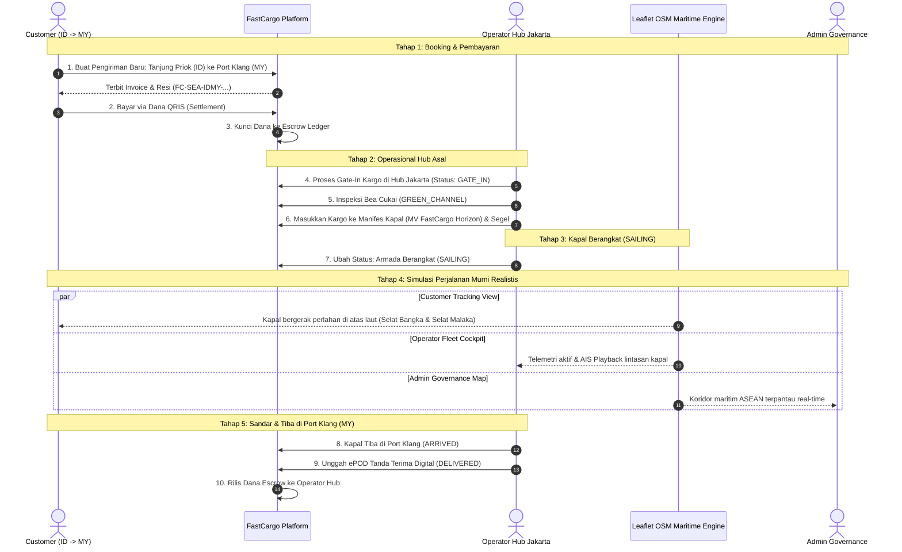
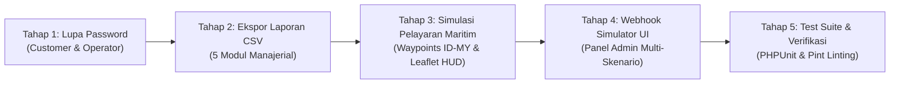

# Rencana Pengembangan 4 Fitur Lanjutan FastCargo Logistics OS
*(Dokumen Diselaraskan Berdasarkan Hasil Audit & Interview Grill-Me)*

Dokumen ini memuat arsitektur, spesifikasi teknis, strategi pengujian, dan implementasi untuk empat fitur lanjutan baru FastCargo, dengan penekanan pada **user-friendly**, **profesionalitas enterprise**, dan **100% GRATIS (zero-cost) tanpa dependensi berbayar**:

1. **Lupa Password (Customer & Operator)** — *Token-based Reset, 2FA Enforced, Dev-Friendly Flash Banner di Layar*.
2. **Ekspor Laporan Manajerial CSV (Excel/Sheets-Ready)** — *Native StreamedResponse, Quick-Presets + Custom Filters, Zero-Cost*.
3. **Simulasi Pelayaran Maritim Dinamis (Indonesia ke Malaysia) & AIS Playback** — *Realistis Otomatis saat Kargo "SAILING", Waypoints Maritim Selat Malaka, Tanpa Tembus Daratan, Multi-Role (Customer, Operator, Admin)*.
4. **Notifikasi Webhook Simulator UI (Payment Sandbox Testbed)** — *1-Click Sandbox Test Data Generator, Live JSON Inspector, Escrow Verification*.

---

## 1. Arsitektur & Peta Alur Demo Lengkap (Mulai dari Awal)

---

## 2. Rincian Teknis & Keputusan Desain Terpilih

### Fitur 1: Lupa Password (Customer & Operator)

* **Prinsip Keamanan:** Token acak 64 karakter berbatas waktu kedaluwarsa 60 menit. Reset password **tidak menghapus kewajiban 2FA TOTP** saat login berikutnya.
* **Isolasi Subdomain & Role:** Permintaan pada `customer.fastcargo.local` hanya melayani akun `RETAIL_CUSTOMER` & `CORPORATE_USER`. Permintaan pada `operator.fastcargo.local` hanya melayani akun `OPERATOR_USER`.
* **Mekanisme Gratis & User-Friendly di Pengembangan:**
  * Di lingkungan lokal (`APP_ENV=local`), sistem selain menulis email ke `storage/logs/laravel.log`, juga langsung menampilkan **banner notifikasi dev di layar lengkap dengan tombol 1-klik "Buka Link Reset"**.
  * Pengembang tidak perlu membuka terminal/log dan tidak perlu setup akun pihak ketiga berbayar (100% gratis & instan).
* **File Terlibat:**
  * `app/Modules/Customer/Controllers/Auth/ForgotPasswordController.php` & `ResetPasswordController.php`
  * `app/Modules/Operator/Controllers/Auth/ForgotPasswordController.php` & `ResetPasswordController.php`
  * `resources/views/customer/auth/forgot-password.blade.php` & `reset-password.blade.php`
  * `resources/views/operator/auth/forgot-password.blade.php` & `reset-password.blade.php`
  * `resources/views/emails/password-reset.blade.php`

---

### Fitur 2: Ekspor Laporan Manajerial CSV (Excel/Sheets-Ready)

* **Prinsip Zero-Cost & Efisiensi:** Menggunakan `StreamedResponse` bawaan Laravel dan fungsi native PHP `fputcsv()`. Header dilengkapi **UTF-8 BOM (`\xEF\xBB\xBF`)** agar karakter aksen, pemisah koma, dan simbol mata uang langsung terbuka rapi di Microsoft Excel tanpa error format.
* **Fitur Antarmuka Pengguna (User-Friendly):**
  * Sederet tombol preset 1-klik: `Semua Data`, `Bulan Ini`, `30 Hari Terakhir`, `Hari Ini`.
  * Input rentang tanggal kustom (`start_date` s.d. `end_date`) dan filter status per kategori.
* **5 Kategori Laporan:**
  1. **Laporan Invoice & Pendapatan:** Nomor invoice, customer, no resi, nominal, status, waktu pelunasan, tx ref.
  2. **Laporan Manifes & Kontainer:** No manifes, kapal/armada, voyage, pelabuhan asal/tujuan, status, total koli.
  3. **Laporan Escrow & Bagi Hasil:** No resi, nominal bruto, milestone 1 (30%), milestone 2 (40%), milestone 3 (30%), bagi hasil operator (78%), fee platform (12%), pajak (10%).
  4. **Laporan Konsinyasi & Tracking:** Waybill, shipper, rute koridor, status milestone terakhir, koordinat GPS.
  5. **Laporan Jejak Audit Governance:** User ID, role, aksi, modul, IP address, waktu, deskripsi.

---

### Fitur 3: Simulasi Pelayaran Maritim Dinamis (Indonesia -> Malaysia) & AIS Playback

* **Konsep Murni Realistis (Pure Realism):**
  * **Pemicu Otomatis:** Begitu status kargo mencapai `SAILING` (Armada Berangkat), peta kargo secara otomatis menjalankan simulasi pergerakan kapal berlayar perlahan di latar belakang tanpa tombol demo mainan.
  * **Waypoints Maritim Nyata (Tidak Menembus Pulau Sumatera):**
    Rute maritim Tanjung Priok (Jakarta) menuju Port Klang (Malaysia) menyusuri alur navigasi laut resmi:
    1. *Tanjung Priok Port, Jakarta* (`-6.102, 106.885`)
    2. *Keluar Teluk Jakarta / Laut Jawa* (`-5.750, 106.850`)
    3. *Titik Masuk Selat Bangka Selatan* (`-3.050, 106.100`)
    4. *Perairan Selat Bangka* (`-2.300, 105.350`)
    5. *Laut Natuna / Selat Riau* (`-0.500, 104.800`)
    6. *Pintu Masuk Timur Selat Singapura* (`1.280, 104.250`)
    7. *Alur Pemisah Lalu Lintas (TSS) Selat Malaka Selatan* (`1.350, 103.500`)
    8. *Selat Malaka Tengah (Lepas Pantai Melaka)* (`2.100, 102.200`)
    9. *Pintu Masuk Alur Pelayaran Port Klang* (`2.850, 101.250`)
    10. *Port Klang Terminal, Selangor, Malaysia* (`3.002, 101.398`)
  * **Visualisasi & Telemetri HUD:**
    * Ikon kapal kargo berputar dinamis mengikuti sudut derajat haluan (*heading degrees*).
    * Jejak garis laut (*wake trail*) berwarna biru bercahaya yang ditinggalkan di belakang kapal.
    * Panel HUD real-time: Kecepatan riil (`16.8 knots`), Arah (`332° NW`), Koordinat GPS langsung berubah halus, dan Sisa Jarak (*Nautical Miles*).
  * **Dukungan Multi-Role:**
    * **Customer:** Melihat kapal pengangkut paketnya sedang berlayar di atas perairan internasional menuju Malaysia.
    * **Operator & Admin:** Melihat armada kapal di Cockpit Fleet Telemetry dan dapat meninjau riwayat koordinat yang tercatat di tabel `ops_fleet_telemetry`.
  * **100% Gratis:** Menggunakan OpenStreetMap via Leaflet.js dengan rotasi SVG native (zero cost).

---

### Fitur 4: Notifikasi Webhook Simulator UI (Payment Sandbox Testbed)

* **Prinsip Keamanan & User-Friendly:**
  * Dilengkapi tombol 1-klik: **"Buat Transaksi Sandbox Otomatis"** untuk pengujian instan tanpa mengganggu pembukuan riil.
  * Dropdown pemilihan invoice pending yang ada.
  * Pembatasan keamanan: Transaksi uji menggunakan penanda `SANDBOX-` untuk mengisolasi dari pembukuan riil.
* **Skenario Simulasi Dana SNAP API:**
  * `SETTLEMENT (00)` — Simulasi pelunasan sukses (invoice `PAID_SETTLED`, Escrow terisi).
  * `EXPIRED (01)` — Simulasi transaksi kedaluwarsa.
  * `FAILED (02)` — Simulasi kegagalan otorisasi pembayaran.
  * `CANCELLED (03)` — Simulasi pembatalan transaksi oleh pengguna.
* **Inspector JSON & Status Monitor:**
  * Kotak visual menampilkan Raw Request Payload (JSON terformat rapi).
  * Panel respon server (`HTTP Status Code`, `responseCode: 2002500`, dan audit message).

---

## 3. Urutan Tahapan Eksekusi Pengerjaan

---

## 4. Kriteria Penerimaan (*Acceptance Criteria*)

- [ ] Pengguna Customer dan Operator dapat meminta link reset password melalui portal masing-masing dan sukses mengganti password.
- [ ] Di lingkungan pengembangan lokal, banner link reset muncul di layar tanpa perlu mengecek terminal log secara manual.
- [ ] Percobaan login dengan password baru tetap mewajibkan verifikasi 2FA TOTP.
- [ ] Seluruh 5 laporan manajerial dapat diekspor menjadi file `.csv` dengan header UTF-8 BOM yang langsung rapi di Microsoft Excel.
- [ ] Tombol preset 1-klik (Bulan Ini, 30 Hari, Semua) berfungsi akurat menyaring data ekspor.
- [ ] Saat kargo berstatus `SAILING`, peta tracking Customer, Operator, dan Admin otomatis memperlihatkan kapal berlayar perlahan menyusuri Selat Bangka & Selat Malaka menuju Malaysia tanpa menembus pulau Sumatera.
- [ ] HUD telemetri di peta menampilkan kecepatan maritim dinamis (~16-18 knots), arah heading kapal yang berotasi otomatis, dan koordinat GPS riil.
- [ ] Webhook simulator berhasil menguji skenario settlement, expired, failed, dan cancelled dengan tampilan payload JSON yang jelas.
- [ ] Seluruh suite pengujian otomatis (`php artisan test`) lulus 100% tanpa regresi.
